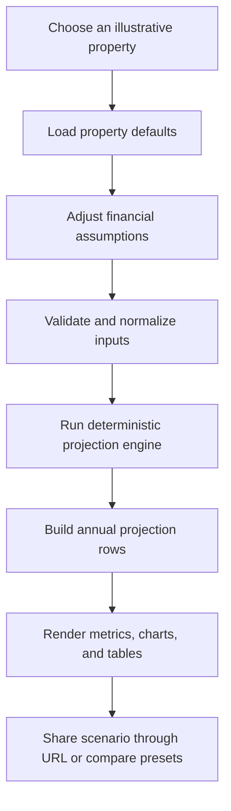

<div align="center">
  

  <h3>Explore property scenarios. Understand the assumptions. Make more informed decisions.</h3>

  <p>
    An educational real estate investment simulator for exploring rental cash flow,
    property appreciation, distribution options, and long-term scenarios.
  </p>

  <p>
    
    
    
    
    
  </p>
</div>

---

> **Important:** ESTA is an educational simulator. The included properties, prices, yields, occupancy assumptions, maintenance costs, and projections are illustrative and hypothetical. They are not verified listings or market data, and none of the example properties is offered for purchase through this application. Results are not guaranteed and are not investment, legal, accounting, or tax advice.

## At a glance

ESTA lets a user choose an illustrative property, adjust the assumptions that drive its financial performance, and see how those assumptions affect modeled outcomes over time. It is designed to make the mechanics behind a property scenario easier to understand, rather than to predict future market performance.

The application currently includes:

- A property discovery page with residential, commercial, and multifamily examples.
- Filters and sorting for browsing the mock property dataset.
- An interactive simulator with editable investment, rental, operating-cost, maintenance, inflation, appreciation, and sale-cost assumptions.
- Ten-year financial projections, including a year-by-year breakdown.
- Payout and reinvestment distribution modes.
- Conservative, base, and optimistic scenario comparisons.
- Shareable URLs that preserve supported simulator settings.
- Validated property records and bounded user inputs.
- Unit tests for key finance, URL parsing, data, and rendering behavior.

## Brand preview

The repository includes an ESTA logo, a social preview image, a hero background, and property image assets.


The image above is brand artwork used for social sharing. It is **not** a screenshot of a verified running build. Add real screenshots of the homepage, simulator, and comparison page to `docs/screenshots/` once the app has been built and checked in a browser.

## Product status

This repository is a client-side educational MVP in active development.

| Area | Current state |
|---|---|
| Property records | Six illustrative, schema-validated records |
| Financial calculations | Deterministic TypeScript projection engine |
| User accounts and database | Not included; the current model runs in the browser/application code |
| Live property data | Not included |
| Saved server-side portfolios | Not included |
| Payments or investments | Not included |
| Legal fractional ownership | Not implemented or represented |
| Currency in this code snapshot | AED (UAE dirhams) |
| Planned currency change | USD is part of the product roadmap, but the conversion is not implemented in this snapshot |

Do not simply change an `AED` label to `$`. A USD release must also replace or convert the underlying mock monetary values, update formatting and URLs, adjust tests, and define how older share links are handled. Until that work is complete, the existing code and dataset should be understood as AED-based.

## How it works



There is no AI service or external data API in the current calculation flow. Given the same property and valid assumptions, the finance engine produces the same results.

## Financial methodology

The projection engine lives in `src/lib/finance/projections.ts`. It is a pure TypeScript function: it does not perform network requests, read from a database, or use random values. The user interface and the annual table/chart are built from the same projection rows so that those views share the same calculated results.

### 1. Property value over time

Let:

- \(V_0\) = starting property value.
- \(g\) = assumed annual property appreciation rate.
- \(t\) = year of the modeled holding period.

The modeled property value at the end of year \(t\) is:

\[
V_t = V_0(1+g)^t
\]

Rent for year \(t\) is calculated using the property value at the start of that year, \(V_{t-1}\).

### 2. Rental income and operating costs

Let:

- \(y\) = assumed gross rental yield.
- \(o\) = occupancy rate, from 0 to 1.
- \(e\) = operating expense ratio, from 0 to 1.
- \(m_0\) = starting annual maintenance assumption.
- \(\pi\) = annual inflation assumption.

The model calculates:

\[
\text{Gross potential rent}_t = V_{t-1}y
\]

\[
\text{Collected rent}_t = V_{t-1}y o
\]

\[
\text{Operating expenses}_t = \text{Collected rent}_t e
\]

Maintenance can be modeled in either of two ways:

- **Fixed:** maintenance remains at \(m_0\) each year.
- **Inflation adjusted:** \(m_t=m_0(1+\pi)^{t-1}\).

The annual property-level net cash flow is:

\[
C_t = \text{Collected rent}_t - \text{Operating expenses}_t - m_t
\]

This is a simplified model. It does not separately model every cost that can occur in an actual property investment.

### 3. Initial modeled ownership share

The simulator uses a simplified proportional ownership assumption:

\[
s_0 = \frac{I}{V_0}
\]

where \(I\) is the initial investment.

This assumes an unlevered property and treats the amount invested as a direct proportion of the property's value. It does not implement legal token ownership, a fund structure, financing, platform fees, minimum lot sizes, secondary-market liquidity, or a contractual distribution waterfall.

### 4. Investor distributions

The investor's modeled distribution for year \(t\) is based on the share held during that year:

\[
D_t = s_{t-1}C_t
\]

A negative property-level cash flow produces a negative modeled investor distribution, representing a pro-rata shortfall under the current simplified model. It should not be interpreted as a fully implemented capital-call process.

ESTA offers two modes:

- **Payout:** the modeled distribution is received as cash and included in cumulative cash distributions.
- **Reinvest:** the modeled distribution is used to purchase more modeled units at the end-of-year property value. It is not also counted as cash.

The current reinvestment logic is an approximation. In particular, negative cash flow, available ownership, and the possibility of modeled ownership exceeding 100% need additional guardrails before any commercial use of the result. The tool does not implement a real fund or property ownership system.

### 5. Holding value and total economic value

The investor's modeled holding value is:

\[
H_t = s_t V_t
\]

Total economic value before hypothetical sale costs is:

\[
E_t = H_t + K_t
\]

where \(K_t\) is cumulative cash distributions paid to the investor. Reinvested distributions are reflected in the modeled share and are not added again as cash.

### 6. Hypothetical total return on investment

The engine calculates total ROI as if the modeled holding were sold at the end of the relevant year, deducting the configured sale-cost rate \(q\):

\[
\text{ROI}_t = \frac{H_t(1-q)+K_t-I}{I}
\]

This is a hypothetical exit calculation, not an actual sale offer or a forecast. Year zero currently reflects the immediate-exit sale-cost assumption, which can make the starting ROI negative when sale costs are nonzero.

### 7. Inflation-adjusted value

The model converts nominal total economic value into an estimate of today's purchasing power:

\[
\text{Real value}_t = \frac{E_t}{(1+\pi)^t}
\]

This adjustment uses the inflation assumption entered by the user. It is not based on a live inflation feed.

### 8. Cash-on-cash return

The underlying engine calculates the annual distribution as a proportion of the initial investment:

\[
\text{Distribution return}_t = \frac{D_t}{I}
\]

This describes a cash-on-cash return only when the distribution is actually paid out. In reinvestment mode, the distribution is reinvested rather than received as spendable cash, so the UI label and interpretation must account for the selected mode.

### Rounding

Calculations retain floating-point precision internally. Monetary values and percentages are rounded for display, not at every intermediate step. This is a simplified planning calculator, not an accounting ledger.

## Default illustrative properties

All six records in `src/lib/data/properties.ts` are marked `isMock: true` and validated against the property schema in `src/types/property.ts`.

| Example property | Asset type | Modeled value (AED) | Gross yield | Occupancy | Annual maintenance (AED) | Operating expense ratio | Appreciation assumption |
|---|---|---:|---:|---:|---:|---:|---:|
| Marina Residence | Residential | 1,800,000 | 6.5% | 92% | 1,200 | 25% | 3.0% |
| Business District Tower | Commercial | 3,200,000 | 7.0% | 90% | 3,000 | 28% | 3.5% |
| Palm Garden Villas | Residential | 2,400,000 | 5.8% | 94% | 2,000 | 22% | 3.0% |
| Creek Harbour Offices | Commercial | 4,500,000 | 7.4% | 87% | 4,500 | 30% | 3.5% |
| Al Barsha Apartments | Multifamily | 5,600,000 | 6.9% | 93% | 5,500 | 26% | 2.8% |
| Village Circle Residences | Multifamily | 3,900,000 | 7.2% | 91% | 3,800 | 27% | 3.2% |

These numbers exist to make the simulator usable and demonstrate how assumptions affect a model. They are not confirmed market values, observed rental yields, occupancy statistics, or investable opportunities.

## Scenario comparison

The comparison page shows conservative, base, and optimistic scenarios. The current implementation applies explicit assumption changes to each property's defaults while preserving the selected investment amount, sale-cost setting, maintenance mode, and distribution mode.

It does not currently represent probability-weighted forecasts, confidence intervals, Monte Carlo simulations, or an expected return guarantee. Scenario labels describe alternative assumptions, not predictions of what will happen.

## Routes

| Route | Purpose |
|---|---|
| `/` | Browse, filter, and sort illustrative properties |
| `/simulator/[propertyId]` | Adjust assumptions and explore projections for one property |
| `/compare` | Compare conservative, base, and optimistic assumption sets |
| Unknown `/simulator/[propertyId]` | Returns the not-found state for an unsupported property ID |

### Shareable URLs

Simulator settings can be represented in URL query parameters. Only values that differ from the property's defaults are included when the URL is encoded.

Example in the current AED-based format:

```text
/simulator/marina-residence?investment=25000&occupancy=84&yield=5.5&inflation=3.5&appreciation=1&opex=30&saleCost=2&maintenance=1700&maintenanceMode=fixed&distributions=reinvest
```

Percentage inputs in URLs use percentage points (`occupancy=84` means 84%, not `0.84`). The parser validates and clamps supported values. Related code lives in:

- `src/lib/simulator/params.ts`
- `src/lib/properties/query.ts`
- `src/lib/compare/params.ts`
- `src/lib/url.ts`

The current comparison URL carries the property, investment amount, and distribution mode; it does not preserve every custom simulator assumption. The comparison page uses the defined scenario presets.

## Tech stack

- **Next.js App Router** — routing, page composition, and server-rendered entry points.
- **React 19** — interactive simulator controls and views.
- **TypeScript** — typed property data and finance inputs/results.
- **Tailwind CSS 4** — styling.
- **Recharts** — projection and comparison charts.
- **Zod** — validation of property records and simulator inputs.
- **Vitest** — unit and render tests.
- **Lucide React** — interface icons.
- **Plus Jakarta Sans** — bundled font family currently included by the project.

The current app does not require a database, authentication provider, payment provider, AI API key, or external property-data API to run.

## Getting started

### Requirements

- Node.js 20.9 or later.
- npm (the repository includes `package-lock.json`).
- Git, if you plan to clone and contribute.

### 1. Clone the repository

```bash
git clone <your-repository-url>
cd esta
```

Replace `<your-repository-url>` with the URL of your GitHub repository.

### 2. Install dependencies

```bash
npm ci
```

If you are intentionally changing dependency versions, use `npm install` and commit the resulting lockfile update. For repeatable installs and CI, prefer `npm ci`.

### 3. Start the development server

```bash
npm run dev
```

Open [http://localhost:3000](http://localhost:3000).

No `.env` file is required for the current client-side application.

## Available scripts

| Command | Purpose |
|---|---|
| `npm run dev` | Start the Next.js development server |
| `npm run build` | Create a production build |
| `npm run start` | Start the production server after a successful build |
| `npm run lint` | Run ESLint |
| `npm test` | Run the Vitest test suite once |
| `npm run typecheck` | Run TypeScript without emitting files |

Before publishing a release, run the full verification sequence:

```bash
npm ci
npm run typecheck
npm run lint
npm test
npm run build
npm run start
```

Then smoke-test the homepage, a known simulator URL, the comparison page, and an unknown property URL in a browser. A successful TypeScript check alone does not prove the production application works.

> **Verification note:** the source archive used to write this README has not yet been confirmed to pass a clean install, test run, lint, typecheck, and production build in a fresh environment. Run the commands above before advertising the release as build-verified.

## Project structure

```text
esta/
├── public/
│   ├── images/
│   │   ├── backgrounds/       # Hero background
│   │   ├── branding/          # Logos and Open Graph artwork
│   │   ├── placeholders/       # Fallback artwork
│   │   └── properties/        # Illustrative property images
│   ├── favicon.ico
│   └── icon.png
├── src/
│   ├── app/
│   │   ├── simulator/[propertyId]/ # Individual property simulator
│   │   ├── compare/                # Scenario comparison page
│   │   ├── globals.css
│   │   ├── layout.tsx
│   │   └── page.tsx
│   ├── components/                 # UI and interactive workspaces
│   ├── lib/
│   │   ├── compare/                # Comparison query parsing
│   │   ├── data/                   # Mock property data
│   │   ├── finance/                # Deterministic finance model and tests
│   │   ├── properties/             # Filtering, sorting, and parsing
│   │   ├── simulator/              # Simulator URL state and tests
│   │   ├── format.ts               # Currency and percentage formatting
│   │   └── url.ts                  # Query parameter helpers
│   ├── proxy.ts                    # Unknown simulator route handling
│   └── types/                      # Shared property types and schema
├── eslint.config.mjs
├── next.config.ts
├── package.json
├── package-lock.json
├── tsconfig.json
└── vitest.config.mts
```

## Testing approach

Tests are included for important pure logic and selected UI rendering behavior, including:

- Projection engine calculations and financial summaries.
- Input validation and assumption bounds.
- Scenario comparison calculations.
- Property record validation.
- Property filtering and sorting.
- Simulator and comparison query parameters.
- Finance presentation helpers.
- Selected chart and table rendering.

Keep financial tests deterministic. When correcting a financial formula, add regression tests for normal conditions, boundary conditions, negative cash flow, zero investment where allowed, and long-horizon reinvestment behavior.

## Design and assets

The project keeps artwork in `public/images/` so components can reference it without embedding images in source files.

- `public/images/branding/esta-logo.png` — primary logo.
- `public/images/branding/esta-logo-light.png` — alternate logo for dark backgrounds.
- `public/images/branding/esta-emblem.png` — emblem-only variant.
- `public/images/branding/og-image.jpg` — social preview artwork.
- `public/images/backgrounds/hero.webp` — homepage hero background.
- `public/images/properties/` — illustrative property imagery.
- `public/images/placeholders/property-fallback.svg` — fallback when a property image is missing.

Use the existing brand system consistently. Before publishing, check that every asset loads in a production build and that text placed over imagery has sufficient contrast.

## Deployment

ESTA is a Next.js application and can be deployed to a compatible Node.js host or a managed Next.js hosting provider.

A typical production workflow is:

1. Push the repository to GitHub.
2. Configure the host to use the repository and its lockfile.
3. Set the required Node.js version to 20.9 or later.
4. Use `npm ci` for dependency installation.
5. Use `npm run build` as the build command.
6. Use the hosting platform's standard Next.js start/runtime settings.
7. Test the deployed homepage, simulator, comparison page, images, and shared URLs.

The current application has no server-side secret configuration. If a database, property-data provider, account system, or payment integration is added later, credentials must be stored as server-side environment variables and never included in client bundles.

## Known limitations

ESTA is not a live property marketplace or an investment platform. The current implementation does not include:

- Verified listings or live real estate pricing.
- Real ownership records, legal tokenization, or investment execution.
- A property fund, financing, leverage, or a contractual distribution waterfall.
- Taxes, every transaction cost, platform fees, liquidity discounts, capital calls, or market volatility.
- Actual market forecasts or probability-weighted return estimates.
- Authentication, user accounts, a database, persistent saved portfolios, or team workspaces.
- Payment processing or investor onboarding.

The finance engine also needs additional guardrails around negative cash flow in reinvestment mode and maximum modeled ownership before results are relied on for commercial decisions. Reinvestment-mode terminology should distinguish distributions generated from cash actually paid out. These are known productization tasks, not features to assume are complete.

The comparison flow currently evaluates its defined presets against property defaults and selected investment/mode settings; it does not carry every custom simulator assumption into the comparison page. This behavior should remain explicit in the UI until the flow is changed.

## Roadmap

The intended order of work is:

1. **Financial correctness:** resolve negative cash flow, reinvestment ownership limits, ROI semantics, and mode-aware labels.
2. **Functional polish:** make comparisons clear, preserve or disclose custom assumptions, and refine shareable scenario behavior.
3. **Brand and currency:** upgrade typography, rewrite robotic copy, and move to USD only after revising or explicitly converting the underlying illustrative monetary values. Do not change currency symbols alone.
4. **Trust and methodology:** explain assumptions and exclusions where users make decisions.
5. **Verification and deployment:** clean install, typecheck, lint, tests, production build, browser checks, and a stable public URL.
6. **User validation:** test with real users and prioritize changes based on observed needs.
7. **Optional SaaS features:** consider accounts, saved scenarios, exports, and team access only when there is evidence users need them.
8. **Separate investment-platform work:** actual fractional ownership would require an independently defined legal, operational, data, and compliance model.

## Contributing

Contributions and thoughtful issue reports are welcome. When proposing a change:

1. Explain the user problem being solved.
2. Keep financial calculations in the finance module rather than duplicating them in UI components.
3. Add or update tests for behavior changes.
4. Preserve validation and clear assumptions.
5. Run lint, typecheck, tests, and build before submitting a pull request.
6. Never replace a mock property with a purported real listing without verifiable source information and clear data provenance.

## Disclaimer

ESTA is for education and scenario exploration only. Outputs are mathematical results derived from user-entered assumptions and illustrative property records. Actual property performance can differ significantly. The application does not provide investment, legal, accounting, or tax advice and does not offer or facilitate the purchase of any property or ownership interest.

