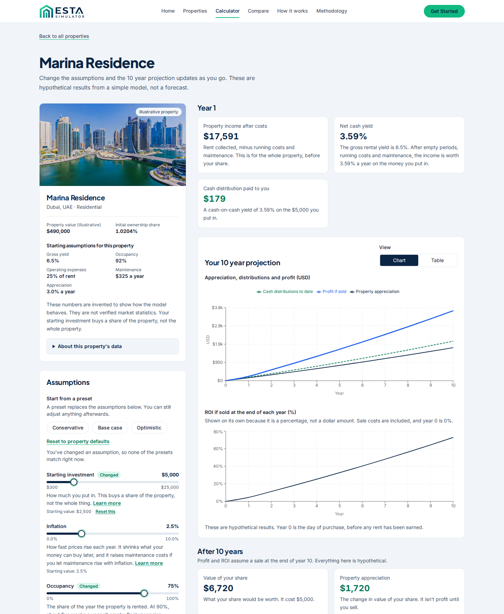
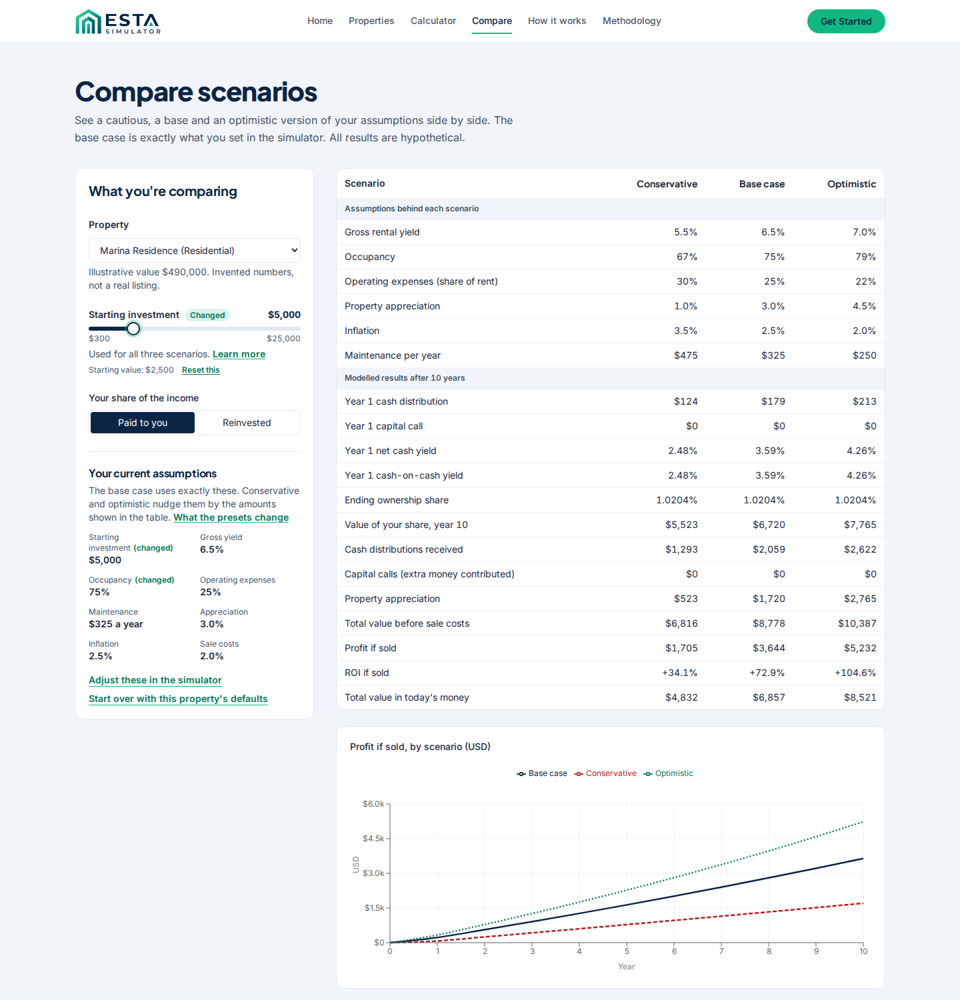
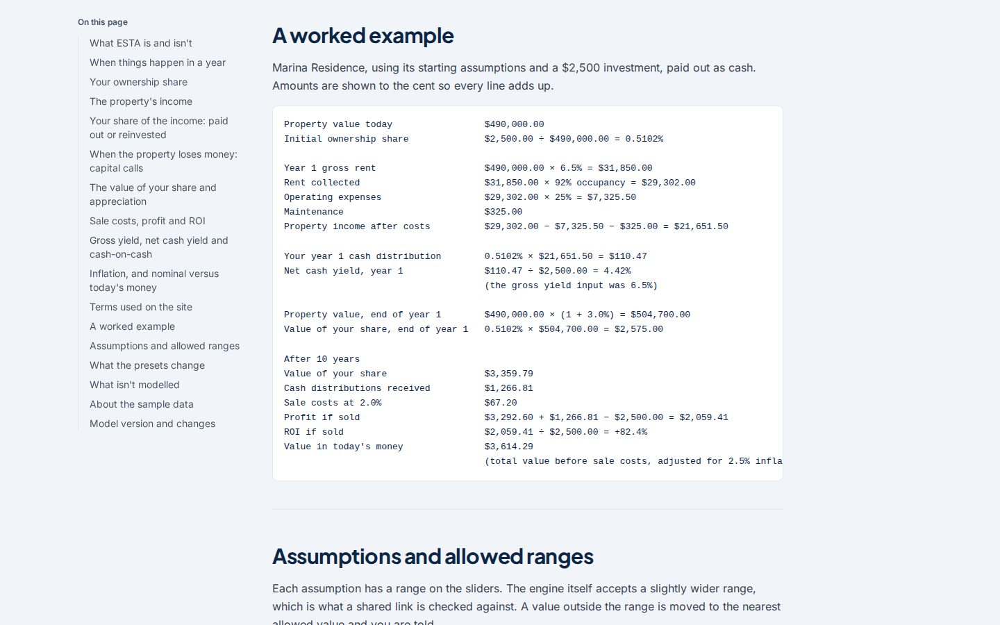
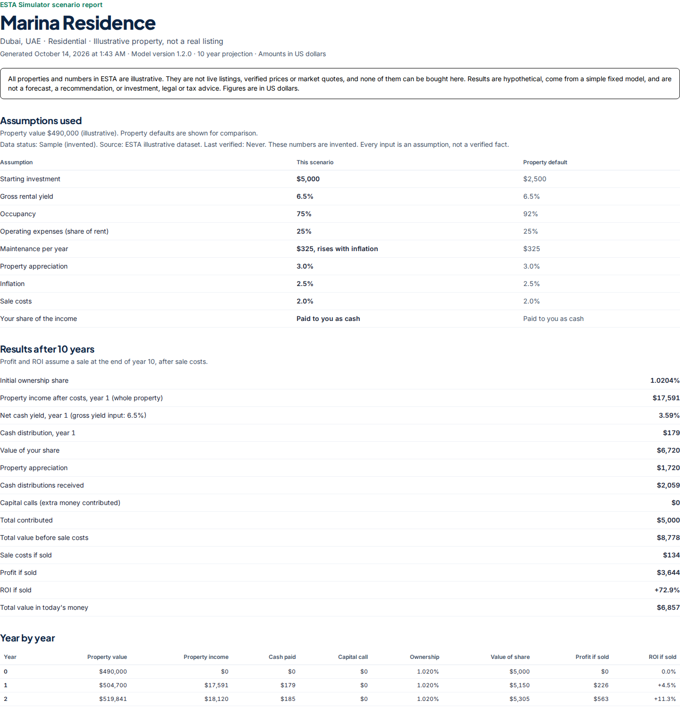
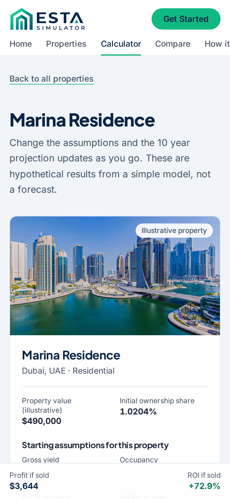

# ESTA Simulator

A learning tool that shows how a property investment could behave over ten years under assumptions you choose. Pick a sample property, change the occupancy, costs, inflation and growth, and compare cautious, base and optimistic versions side by side.

> **Everything here is illustrative.** The six properties are invented, the numbers are assumptions, and results are hypothetical. Nothing is for sale, nothing is a recommendation, and nothing is investment, legal or tax advice. Amounts are in US dollars.


| Simulator | Compare |
| --- | --- |
|  |  |

| Methodology | Printable report | On a phone |
| --- | --- | --- |
|  |  |  |

## Run it
```bash
npm install        # or npm ci for a clean, exact install
npm run dev        # http://localhost:3000
```

| Command | What it does |
| --- | --- |
| `npm test` | Unit and render tests |
| `npm run typecheck` | TypeScript, no emit |
| `npm run lint` | ESLint |
| `npm run build` | Production build |
| `npm run check:routes` | Serve the production build, request every route, and fail on a bad status or any server log error (run after `build`) |
| `npm run test:e2e` | Browser smoke tests (needs `build` first, and a browser: `npx playwright install chromium`) |
| `npm run docs:methodology` | Regenerate `MODEL_METHODOLOGY.md` from its source |
| `npm run validation:summary` | Summarise user sessions (see below) |
| `npm run validation:template` | Rewrite the session CSV template |

Optional settings, in `.env.local` (see `.env.example`). Both are public values.
- `NEXT_PUBLIC_SITE_URL`: your real address, used for canonical links, the social preview and the sitemap. On Vercel the production address is picked up automatically.
- `NEXT_PUBLIC_FEEDBACK_URL`: a `mailto:` link or an `https://` form. When set, the footer shows a feedback link. When not, nothing is shown.

## What's where
- `src/lib/finance/` the projection engine: pure, deterministic TypeScript. The model notes are at the top of `projections.ts`.
- `src/lib/methodology.ts` the single source for the `/methodology` page and `MODEL_METHODOLOGY.md`.
- `src/lib/finance/definitions.ts` the wording of every defined term, shared by the page, the report and the CSV.
- `src/lib/data/properties.ts` the sample properties, validated at load. `src/types/property.ts` holds the data rules.
- `src/lib/simulator/params.ts`, `src/lib/compare/params.ts`, `src/lib/properties/query.ts` the shareable URL formats, with validation.
- `src/lib/export/csv.ts` and `/simulator/<id>/report` the CSV and the printable report.
- `src/proxy.ts` returns a real 404 for an unknown property.
- `docs/validation/` the kit for testing demand with real people.

## How the numbers work
Read [`MODEL_METHODOLOGY.md`](MODEL_METHODOLOGY.md), or `/methodology` when the app runs. It covers ownership, income, payout versus reinvestment, capital calls, sale costs, ROI, yields, inflation, the allowed ranges, and everything the model leaves out, with a worked example computed by the real engine.

After changing a formula, a definition or a range: bump `MODEL_VERSION` in `src/lib/finance/projections.ts`, add a line to `MODEL_CHANGELOG` in `src/lib/methodology.ts`, then run `npm run docs:methodology`. A test fails if the generated file is out of date.

## Shareable links
Every scenario is a link. Only values that differ from the property's defaults are written, rates are percent points, and anything invalid or out of range is corrected with a visible notice.
- Simulator: `/simulator/marina-residence?v=2&investment=5000&occupancy=75&distributions=reinvest`
- Compare: `/compare?property=marina-residence&v=2&investment=5000&occupancy=75`
- Report: `/simulator/marina-residence/report?v=2&investment=5000&occupancy=75`
- Home filter: `/?type=commercial&sort=yield-desc`

`v=2` marks links with dollar amounts. Older links with amounts (from when the app used AED) are not read as dollars: their amounts are ignored and the person is told.

## Data rules
Every property has a data status, a source, a last verified date, and a sourced or assumption mark on each input. The launch dataset is all `mock`, and a test enforces it. A record can only be `verified` with a source link, a verification date, at least one sourced field and an approver on every change. A verified record not re-checked within 180 days shows as out of date.

## Testing with real people
`docs/validation/` holds a kit for the roadmap's Phase 6: a segment choice, a 45 minute session script, comprehension questions with answers computed by the model, an observation sheet, consent notes, and a summary script that applies the repeated evidence rule and the backend gate. No session results are included, because none have been run.

An 85 second walkthrough is in `esta-demo.mp4` (delivered alongside this project, not committed to the repository).

## Releasing
CI (`.github/workflows/ci.yml`) runs on every push and pull request: strict `npm ci` install, typecheck, lint, tests, production build, a route and server log check, a production dependency audit, then the browser tests. After a deployment, run the **Check a deployed site** workflow with the live address and the commit hash. Step by step instructions and the launch checklist are in [`docs/RELEASE.md`](docs/RELEASE.md). Ongoing data and model upkeep is in [`docs/OPERATIONS.md`](docs/OPERATIONS.md).

The footer shows which commit a site was built from, and every page carries it in `<meta name="build-commit">`.

## Privacy
No accounts, no cookies, no analytics, and no requests to other sites (tests check the last two). See `/privacy`. Update that page before adding anything that changes it.

## Status
Roadmap phases 1 to 6 are built. What needs you: deploying to a public address (needs your hosting account), running the observed sessions, and a final read of the methodology wording by someone accountable for the product.
